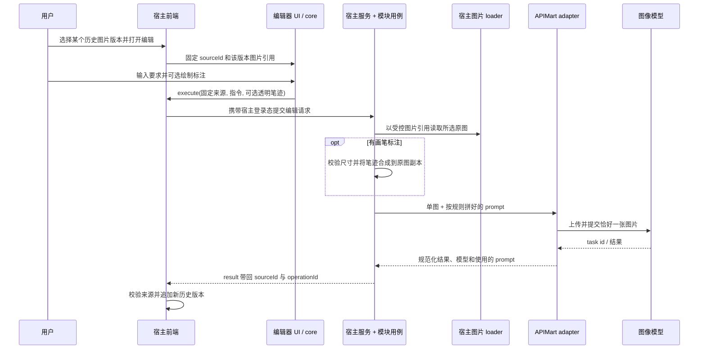

# 图像编辑模块接入指南

状态：模块核心代码、四个导出入口和 React + Express mock 示例已经实现并通过本地页面流程验收。本指南中的接线代码块可按当前入口集成；实际接入任何宿主、窄屏真机检查与干净 tarball 安装仍是独立后续工作。

模块边界和契约以[架构方案](../02-架构方案.md)为准；阶段和当前状态以[开发追踪](../04-开发追踪.md)为准。当前可运行示例：`npm ci` 后运行 `npm test`、`npm run build`、`npm run example`。

## 1. 拆成什么，为什么这样拆

目标是提取完整的“针对已有图片做一次编辑”能力，不是单独复制画笔窗口，也不是把新品图生成器整套业务复制过来。建议在同一仓库提供四个明确入口：

| 层 | 模块实现 | 宿主适配点 | 依赖方向 |
| --- | --- | --- | --- |
| `core` | 输入/结果/错误类型、指令和图像校验、提示词拼装、contain 坐标换算 | 无业务 store；宿主传递图片 ID 和编辑文字 | 不依赖其它层或运行时 |
| `react` | 编辑弹窗、图层、工具栏、草稿状态、提交时序 | 宿主传入图片、打开状态、提交函数和结果回调 | `react → core` |
| `server` | 服务端编辑用例、图片读取和限制、标注合成、错误归一化 | 宿主提供鉴权、图片 loader、存储引用校验、速率/预算策略 | `server → core`，并注入 provider/图片组件 |
| `adapters/apimart` | 上传图片、创建任务、查询状态、解析结果 URL | 宿主服务注入密钥读取、超时和运行环境配置 | adapter 实现 server 所需的 provider 合约 |

这样的拆分让不同产品可以复用相同提示词、画笔语义和 APIMart 流程，同时把各自的登录方式、商品/方案数据结构、图片存储和版本历史留在宿主中。若某项目不使用 React，可以重用 `core` 和服务合同，自己实现 UI；若项目不是 Node 服务，需额外实现服务边界/adapter，不能直接运行 Node 服务模块。

首版采用单仓库、多显式入口；不是四个仓库，也不是一个必须部署的云服务。先在独立模块仓库的 React + Express mock 示例中验证边界，之后再按目标项目选择本地版本化构建产物。公共 npm 包、线上托管和额外模型供应商都需要后续确认。

## 2. 一次编辑的完整链路



有标注时，原图和透明笔迹可以分别传到宿主后端以便本地合成；图像模型只收到合成结果一张图。无标注时模型收到原图一张。标注用于定位，不能单独作为第二张模型图，也不能覆盖原来的历史图。

提示词有标注时为“单图标注前缀 + 用户原文 + 保真后缀”；无标注时为“用户原文 + 保真后缀”。中文后缀固定为“保持原图其他区域的细节不变，保持原图的色彩不变”。颜色只表示位置，具体修改动作由用户文字决定。模块不调用指导重写 LLM。

## 3. 宿主项目需要负责的事情

### 前端

- 在每张图片卡片上提供“图像编辑”入口，并决定当前选中的版本。
- 打开编辑时复制所选版本的 `sourceId` 与图片引用为本次不可变的编辑来源；不要在请求进行时重新读取“当前选中版本”代替它。
- 保持编辑器组件在关闭态仍挂载到请求完成，以便错误时保留文字和笔迹。实际派发后关闭小窗、由宿主主界面显示进度；本地校验/准备失败则留在小窗。
- 成功回调只能把结果追加到 `result.sourceId` 对应的历史分支。结果迟到或用户已切换卡片时，不得写入新选中的无关图片。
- 按结构化错误展示安全提示。`submissionState: unknown` 时提示确认/查询状态，避免将可能已计费的提交盲目重发。

以下为宿主接线示意；实际 props 和类型来自当前 React/core 导出：

```typescript
import { ImageEditorDialog } from 'image-editing-module/react';
import type { ImageEditInput, ImageEditResult, ExecuteImageEdit } from 'image-editing-module/core';

const editingSource = {
  id: selectedVersion.id,
  imageRef: selectedVersion.imageRef,
  previewUrl: selectedVersion.imageUrl,
};

async function executeEdit(input: ImageEditInput, events: Parameters<ExecuteImageEdit>[1]): Promise<ImageEditResult> {
  // 由宿主 transport 在开始发送 HTTP 请求时通知；不是等响应回来再通知。
  return hostApi.editImage(input, {
    onRequestDispatched: events.onDispatched,
  });
}

function handleEditSuccess(result: ImageEditResult) {
  if (result.sourceId !== editingSource.id) return;
  appendVersion({
    sourceId: result.sourceId,
    operationId: result.operationId,
    imageUrl: result.imageUrl,
    promptUsed: result.promptUsed,
  });
}

<ImageEditorDialog
  open={isEditorOpen}
  source={editingSource}
  execute={executeEdit}
  onClose={() => setIsEditorOpen(false)}
  onSuccess={handleEditSuccess}
  onError={(failure) => { setEditorError(failure); setIsEditorOpen(true); }}
/>
```

上例中的 `hostApi.editImage` 是宿主自有 transport。React 模块 `ImageEditorDialog` 的 props 是 `open/source/execute/onClose/onSuccess/onError`；`execute` 需在开始发送 HTTP 请求前调用 `events.onDispatched()`，该事件只表示宿主请求已派发，不代表 APIMart 接受。宿主应让窗口关闭与请求生命周期解耦，失败时根据 `ImageEditFailure.submissionState` 恢复窗口/保留草稿；`unknown` 与已提交但未完成状态不得自动重复提交。

### 后端

- 在现有鉴权之后注册专用图像编辑路由；按宿主用户权限确认图片引用可读、可编辑。
- 提供受控 `loadImage(reference)`，将宿主自己的存储 key、会话 ID 或签名引用解析成图片字节。不要让客户端提交任意 URL 后由服务端直接 fetch。
- 注入 APIMart adapter 和服务端 key getter。只允许服务进程读取 API Key；不要放入 `VITE_*`、React props、浏览器响应、源码示例、错误文本、URL 或日志。
- 当前适配器按 APIMart 官方[图片上传接口](https://docs.apimart.ai/en/api-reference/uploads/images)、图像任务端点和[任务状态查询接口](https://docs.apimart.ai/en/api-reference/tasks/status)实现。任务创建当前使用 `POST /v1/images/generations`，随后使用 `GET /v1/tasks/{task_id}` 轮询；这只描述本次 adapter 协议，不代表已真实联网验证。
- 设置请求体限制时考虑 Base64/JSON 膨胀，并同时限制输入字节、解码后像素/尺寸、合成输出大小和处理超时。不可仅为了让图片“通过”就无限调大 body limit。
- 由宿主决定并实现结果图持久化、签名 URL 刷新、访问权限和历史版本追加。供应商临时结果 URL 过期前要保存或转存，不能假设它永久可用。
- 失败错误返回稳定的安全字段，不把供应商原始 body、Authorization、密钥或 Base64 返回浏览器。

## 4. 在其他项目中接入的步骤

模块当前可生成本地 tarball；发布到公共 npm 未获授权。按以下顺序进行宿主接入：

1. **检查技术边界。** 确认前端 React 版本、Node 版本、打包器、CSP、图片来源和后端部署方式。React + Node/Express 是目标示例；Vue/其它框架可自建 UI，非 Node 后端需适配服务合约。
2. **选分发版本。** 在模块仓库运行 `npm ci`、`npm run build`、`npm pack` 生成版本化 tgz；宿主以本地 tarball 为依赖。不要从某台开发机父目录相对导入，也不要假设仓库已有公共 npm 包。
3. **接前端 UI。** 在图片卡片添加入口；将选中图片固定为 `editingSource`；接入编辑器并提供宿主 HTTP transport、关闭/错误/成功回调。若项目用自己的 UI，只复用 core 契约。
4. **接宿主服务。** 建立鉴权路由，验证用户权限，提供受控 loader，注入图片合成器、APIMart provider 和模型配置。生产 key 存在服务端密钥管理中。
5. **接结果与版本。** 用 `sourceId` 和 `operationId` 关联结果，保存结果图并追加历史版本；保留生成时的提示词和模型元数据。旧图不覆盖。
6. **先 mock 后真机。** 捕获 provider 请求确认只有一张图；测试有标注/无标注、坐标、派发前后失败、迟到响应、重复提交防护、不同来源权限和结果存储。通过 mock 后再按授权进行有限真实模型请求。
7. **在目标项目记录变更。** 将依赖/导入版本、服务端环境变量名（不含值）、部署配置、验收命令和回退步骤记入宿主自己的 README/当前状态；不要把项目密钥写进本模块文档。

## 5. 图片、凭证和网络安全

显示图片成功不代表 Node 服务也能读到它。浏览器中的 blob URL、跨域 CDN、需要 cookie 的代理 URL、短期签名 URL 对后端可能不可用。宿主应传稳定的业务引用，让 loader 在受控权限下读取；如果只能用 URL，宿主必须为域名、重定向、DNS 解析地址、私网/回环/链路本地地址和超时定义并验证策略。仅按 URL 文本检查主机名不是完整 SSRF 防护。

APIMart Key 只由后端读取。模板可用如下名称示意，但这不是本仓库现有配置文件，也不是要求将密钥填进模块仓库：

```dotenv
# 未来由宿主服务配置；真实值由宿主自己的秘密管理方式提供。
APIMART_API_KEY=YOUR_APIMART_API_KEY_HERE
```

客户端仅上传经过宿主授权的来源引用和编辑内容。记录 `operationId`、阶段和安全错误码即可，不记录原图 Base64、Authorization header、完整提示词（除非宿主有明确的隐私/调试策略）或供应商原始响应。

## 6. 错误与交互恢复

当前公开错误结构如下：

```typescript
interface ImageEditFailure {
  code: string;
  stage: 'input' | 'load' | 'compose' | 'upload' | 'submit' | 'poll' | 'result';
  safeMessage: string;
  retryable: boolean;
  submissionState: 'not_submitted' | 'submitted' | 'unknown';
}
```

| 时点 | 窗口/宿主行为 | 是否可直接重试 |
| --- | --- | --- |
| 输入或本地预检失败 | 窗口保留，指出可修复输入 | 修正后可重试 |
| 图片读取/合成失败，尚未发往供应商 | 窗口保留笔迹和文字，宿主说明来源/图片问题 | 处理来源问题后可重试 |
| 请求已派发，供应商明确拒绝 | 窗口恢复并保留草稿；主界面显示安全错误 | 仅在 retryable 且服务端确认未接受或可安全重试时 |
| 连接中断，是否受理未知 | 主界面标记状态待确认；保留操作 ID 与来源 | 不自动重复提交，先查任务或人工确认 |
| 生成成功 | 关闭窗口、清草稿、按固定来源追加新版本 | 新操作可从任意已选版本开始 |

窗口关闭只代表隐藏编辑 UI，不代表取消已经提交给供应商的任务。模块首版不承诺远端任务取消或跨刷新草稿恢复。

## 7. 接入验收清单

- [ ] 从独立模块构建/安装，不引用新品图生成器目录或本机绝对路径。
- [ ] 浏览器打包不包含 Node、Sharp、APIMart Key 或服务端 adapter。
- [ ] 图片卡片选中的版本固定为本次 source；处理中切换选中版本，迟到结果仍关联原 source。
- [ ] contain 留白不产生笔迹；不同显示尺寸与原图尺寸映射准确。
- [ ] 有标注时合成副本并向模型发送一张图；无标注时发送原图一张。
- [ ] 检查标注/无标注提示词前缀、用户原文、保真后缀及中英/混合语言。
- [ ] 请求派发后弹窗关闭且主页面显示进度；派发前失败不误关闭。
- [ ] 失败保留用户输入；未知提交不自动付费重发；重复点击不会并行创建重复任务。
- [ ] 服务端验证来源权限、图片格式、字节数、解码尺寸、标注同尺寸及请求超时。
- [ ] 成功生成只追加版本；图片数据持久化；历史图和策划快照不被覆盖。
- [ ] APIMart 返回 string/array URL 都正确解析；缺少有效 URL 时不能回报成功。
- [ ] mock 验收记录完整，真实模型请求按宿主授权执行并记录成本/模型/结果。

## 8. 常见接入问题

| 表现 | 常见原因 | 定位方向 |
| --- | --- | --- |
| 标注线偏离光标 | 以整张 `` 的外框换算，没扣除 `object-fit: contain` 留白或缩放倍率 | 统一用 core 坐标换算；核对 CSS content box、device scale 和原始像素尺寸 |
| 图片编辑仍像收到了两张参考图 | 请求把干净原图和标注图都传给模型 | 后端先把原图+overlay 合成；在 provider 边界捕获并断言图片数量为 1 |
| 失败后编辑窗回不来或一直转圈 | 宿主只处理成功回调；失败回调未清理忙状态；组件随弹窗卸载 | 执行函数 `finally` 恢复宿主状态；让组件在关闭态仍挂载；根据 submissionState 决定恢复方式 |
| 结果挂到切换后的卡片 | 请求回调读取实时 selectedVersion 而非提交时 sourceId | 请求创建时冻结来源；结果按返回 sourceId/operationId 校验后追加 |
| 图片能显示但服务端加载失败 | 浏览器 cookie/CORS、blob URL 或签名 URL 无法从后端访问 | 使用宿主 loader 和授权图片引用；检查签名过期及服务端权限 |
| 请求体 413 或图片处理耗尽内存 | Base64/JSON 膨胀、忽略解码像素上限、未限制并发 | 使用受控上传/流式策略，设置字节和解码尺寸限制、队列和超时 |
| 浏览器包里出现供应商 SDK/key | 前端直接调用 APIMart 或导入 server 入口 | 限制公开 exports 和 bundler graph；供应商调用只能发生在服务端 |

## 9. 后续宿主集成仍需确定的事项

首个实际接入宿主、宿主自身的结果持久化/source 引用/权限协议、任务状态的查询恢复、并发与成本策略及本地 tarball 的许可/版本策略仍需由后续接入项目确定。它们不阻碍本仓库独立模块验收；真正接入任一宿主仍需单独确认范围。
